# Koperasi Sekolah SMP Negeri 2 Metro

[](https://laravel.com)
[](https://www.php.net)
[](https://www.mysql.com)
[](https://tailwindcss.com)
[](https://alpinejs.dev)
[](https://vitejs.dev)
[](https://midtrans.com)

Aplikasi web Enterprise Resource Planning (ERP) dan Storefront Koperasi Sekolah SMP Negeri 2 Metro berbasis **Laravel 11** dan **MySQL 8**. Mengintegrasikan sistem kasir Point of Sale (POS), toko online mandiri bagi siswa/anggota, pengadaan barang (*purchasing*), manajemen inventaris dengan audit stok opname, pembayaran multi-metode (Cash & QRIS Dinamis), serta laporan akuntansi komprehensif.

**🌐 Website:** [koperasi-teguh.freedev.app](https://koperasi-teguh.freedev.app/)

---

> **Panduan membaca README:** Bagian awal menampilkan halaman-halaman utama aplikasi beserta fungsi setiap peran, kemudian langsung menyajikan tujuh diagram sistem dan penjelasannya. Informasi fitur, teknologi, instalasi, dan deployment tersedia pada bagian berikutnya.

---

## Daftar Isi

- [A. Ringkasan & Akses Aplikasi](#a-ringkasan--akses-aplikasi)
- [B. Tampilan Aplikasi dan Penjelasan Halaman](#b-tampilan-aplikasi-dan-penjelasan-halaman)
  - [Halaman Login Multirole](#1-halaman-login-multirole)
  - [Dashboard Admin](#2-dashboard-eksekutif-admin)
  - [Halaman Anggota](#3-dashboard-toko--pembelian-anggota)
  - [Halaman Gudang](#4-dashboard-inventaris-gudang--sekretaris)
  - [Halaman Kasir / POS](#5-dashboard-kasir-point-of-sale-pos)
- [C. Dokumentasi Diagram Sistem](#c-dokumentasi-diagram-sistem)
  - [Matriks Audit Hak Akses](#8-matriks-audit-hak-akses)
  - [Activity Diagram](#1-activity-diagram--01--proses-checkout--pembayaran)
  - [Component Diagram](#2-component-diagram--02--komponen-aplikasi)
  - [Deployment Diagram](#3-deployment-diagram--03--lingkungan-implementasi)
  - [ERD](#4-entity-relationship-diagram-erd--04--relasi-basis-data-koperasi)
  - [Sequence Diagram](#5-sequence-diagram--05--checkout-qris-anggota)
  - [System Architecture Diagram](#6-system-architecture-diagram--06--arsitektur-sistem)
  - [Use Case Diagram](#7-use-case-diagram--07--fitur-per-peran)
- [D. Tentang Aplikasi](#d-tentang-aplikasi)
- [E. Fitur Aplikasi](#e-fitur-aplikasi)
- [F. Teknologi & Dependensi](#f-teknologi--dependensi)
- [G. Ringkasan Arsitektur Sistem](#g-ringkasan-arsitektur-sistem)
- [H. Struktur Direktori Repository](#h-struktur-direktori-repository)
- [I. Panduan Instalasi Lokal](#i-panduan-instalasi-lokal)
- [J. Informasi Deployment](#j-informasi-deployment)
- [K. Informasi Pengembang](#k-informasi-pengembang)
- [L. Panduan Unggah ke GitHub](#l-panduan-unggah-ke-github)


---

## A. Ringkasan & Akses Aplikasi

**Sistem Informasi Koperasi Sekolah SMP Negeri 2 Metro** merupakan aplikasi berbasis web untuk mendukung pengelolaan operasional koperasi, mulai dari transaksi kasir, belanja anggota, inventaris, pengadaan barang, hingga pelaporan.

**🌐 Website aplikasi:** [https://koperasi-teguh.freedev.app/](https://koperasi-teguh.freedev.app/)

Aplikasi telah di-hosting dan dapat diakses secara online melalui tautan tersebut.

---

## B. Tampilan Aplikasi dan Penjelasan Halaman

Berikut adalah dokumentasi antarmuka aplikasi Koperasi Sekolah SMP Negeri 2 Metro yang diambil langsung dari sistem operasional (folder `laporan/screenshots/`):

### 1. Halaman Login Multirole
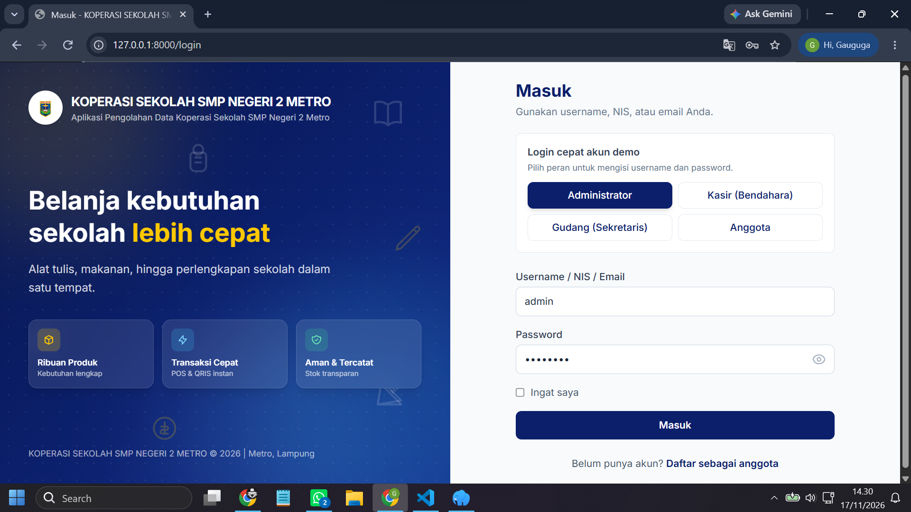
*Antarmuka autentikasi terpadu untuk seluruh pengguna (Admin, Pengurus/Kasir/Gudang, dan Anggota Siswa). Mendukung multi-identifier (dapat masuk menggunakan Username, Nomor Induk Siswa/NIS, atau Email), dilengkapi tombol cepat akun demo per peran (Administrator, Kasir/Bendahara, Gudang/Sekretaris, Anggota), proteksi brute-force rate limiting (maksimal 5 percobaan gagal), tautan pendaftaran anggota mandiri, serta pengalihan halaman awal (redirect) otomatis sesuai peran.*

---

### 2. Dashboard Eksekutif Admin
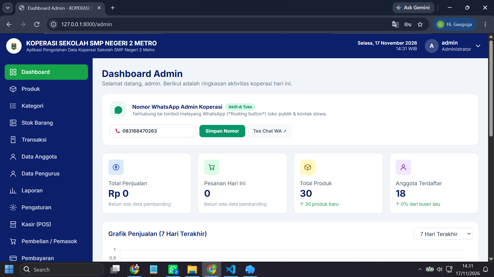
*Pusat kendali eksekutif bagi Administrator dan Ketua Koperasi. Menampilkan kartu metrik real-time: Total Penjualan (omzet transaksi berstatus selesai), Pesanan Hari Ini, Total Produk, dan Anggota Terdaftar; visualisasi tren penjualan berbasis Chart.js (rentang 7 Hari Terakhir, 30 Hari Terakhir, dan Bulan Ini); panel monitoring barang stok menipis dan daftar transaksi terbaru; serta pengaturan nomor WhatsApp admin yang tampil sebagai tombol melayang di toko publik.*

---

### 3. Dashboard Toko & Pembelian Anggota
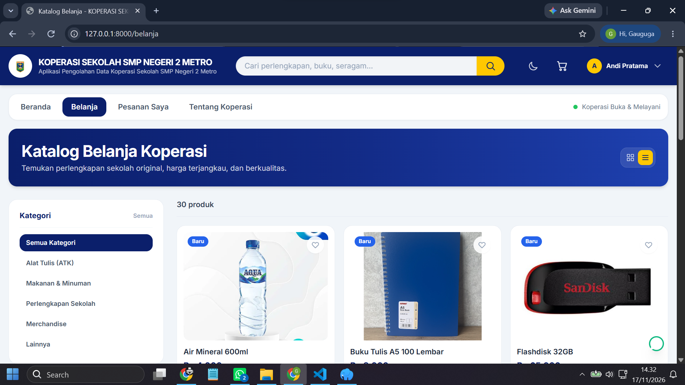
*Etalase belanja daring (*storefront*) bagi anggota/siswa sekolah pada halaman `/belanja`. Dilengkapi pencarian produk pintar, filter kategori (Alat Tulis/ATK, Makanan & Minuman, Perlengkapan Sekolah, Merchandise, Lainnya), indikator status "Koperasi Buka & Melayani", navigasi Beranda – Belanja – Pesanan Saya – Tentang Koperasi, keranjang belanja interaktif, favorit produk, dan pemantauan riwayat status pesanan online.*

---

### 4. Dashboard Inventaris Gudang & Sekretaris
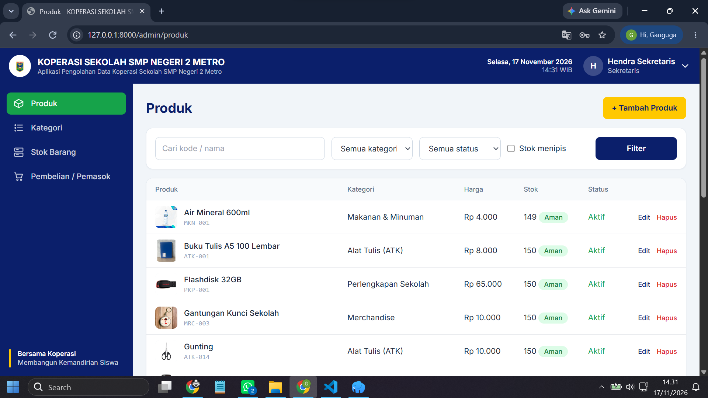
*Panel kerja divisi logistik dan sekretaris koperasi pada halaman `/admin/produk`. Menampilkan tabel master data produk (kode barang, nama, kategori, harga jual, stok, status) dengan filter pencarian kode/nama, kategori, status, dan centang stok menipis; tombol Tambah Produk; serta menu Produk, Kategori, Stok Barang (termasuk riwayat mutasi dan stok opname), dan Pembelian/Pemasok. Foto barang dapat diunggah saat menambah atau mengedit produk.*

---

### 5. Dashboard Kasir Point of Sale (POS)
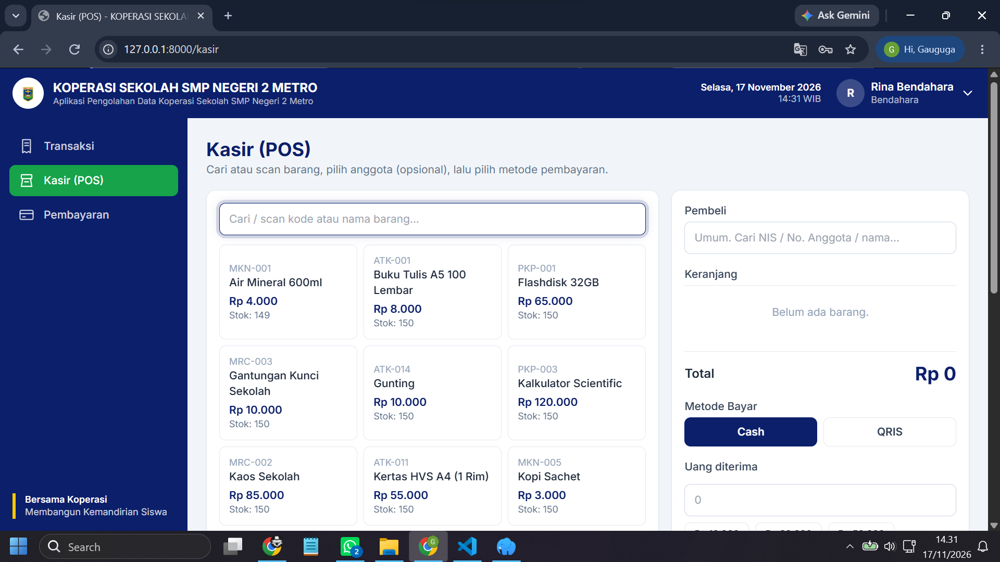
*Antarmuka kasir desktop/tablet berkecepatan tinggi pada halaman `/kasir`, dibangun menggunakan Alpine.js. Mendukung pencarian/scan cepat barang, identifikasi anggota sekolah (berdasarkan NIS/No. Anggota/nama) atau pembeli umum (*guest shopper*), kalkulasi kembalian tunai otomatis, pilihan metode pembayaran Cash atau QRIS, dan pencetakan langsung struk nota thermal 58mm serta unduh PDF.*

---

## C. Dokumentasi Diagram Sistem

Berikut adalah 7 diagram teknis perancangan dan rekayasa perangkat lunak untuk **Sistem Informasi Koperasi Sekolah SMP Negeri 2 Metro** dalam format visual (PNG) yang dilengkapi analisis mendalam, alur kerja operasional, serta korelasi implementasinya pada basis kode:

> **Penting agar gambar tampil di GitHub:** README hanya menampilkan gambar yang file PNG-nya juga sudah di-*commit* ke repository. Seluruh berkas gambar pada proyek ini tersimpan di folder:
> - **Screenshot antarmuka:** `laporan/screenshots/` — `login.png`, `dashboard-admin.png`, `dashboard-anggota.png`, `dashboard-gudang.png`, `dashboard-kasir.png`
> - **Diagram sistem:** `laporan/7-diagram-koperasi-PNG/` — `activity.png`, `component.png`, `deployment.png`, `erd.png`, `sequence.png`, `system-architecture.png`, `use-case.png` (folder `sumber-mmd/` di dalamnya berisi file sumber Mermaid `.mmd` yang dapat diedit ulang)
>
> Pastikan kedua folder tersebut ikut ter-*commit* dan ter-*push* ke GitHub.

| No. | Diagram | Berkas Visual | Fokus Rekayasa Sistem |
| :---: | :--- | :--- | :--- |
| **01** | [Activity Diagram](#1-activity-diagram--01--proses-checkout--pembayaran) | `laporan/7-diagram-koperasi-PNG/activity.png` | Alur siklus pemesanan, verifikasi ketersediaan stok, dan percabangan pembayaran (Cash vs QRIS). |
| **02** | [Component Diagram](#2-component-diagram--02--komponen-aplikasi) | `laporan/7-diagram-koperasi-PNG/component.png` | Dekomposisi modular lapisan antarmuka, routing, controllers, service layer, dan integrasi eksternal. |
| **03** | [Deployment Diagram](#3-deployment-diagram--03--lingkungan-implementasi) | `laporan/7-diagram-koperasi-PNG/deployment.png` | Topologi infrastruktur server, runtime PHP-FPM, penjadwal cron, persistent storage, dan database. |
| **04** | [Entity Relationship Diagram](#4-entity-relationship-diagram-erd--04--relasi-basis-data-koperasi) | `laporan/7-diagram-koperasi-PNG/erd.png` | Skema konseptual 16 tabel relasional, primary/foreign keys, snapshot harga, dan kardinalitas relasi. |
| **05** | [Sequence Diagram](#5-sequence-diagram--05--checkout-qris-anggota) | `laporan/7-diagram-koperasi-PNG/sequence.png` | Urutan pertukaran pesan pada checkout QRIS, transaksi database ACID, dan *pessimistic locking* stok. |
| **06** | [System Architecture Diagram](#6-system-architecture-diagram--06--arsitektur-sistem) | `laporan/7-diagram-koperasi-PNG/system-architecture.png` | Arsitektur multi-layer: Lapisan Aktor, Presentation, Application Core, dan Data & Runtime. |
| **07** | [Use Case Diagram](#7-use-case-diagram--07--fitur-per-peran) | `laporan/7-diagram-koperasi-PNG/use-case.png` | Batasan sistem (*system boundary*), 5 peran pengguna, dan pemetaan hak akses fitur operasional. |

---

### 1. Activity Diagram (`01 — Proses Checkout & Pembayaran`)

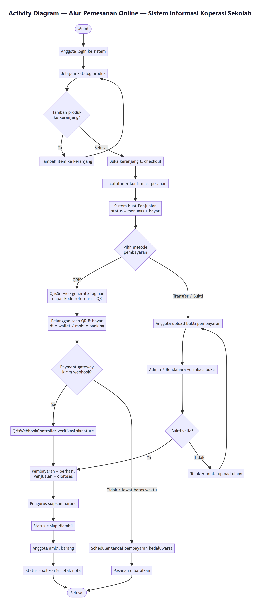

#### A. Deskripsi & Tujuan
Diagram ini memodelkan alur aktivitas dinamis (*behavioral workflow*) dari proses pemesanan barang oleh siswa/anggota koperasi melalui portal *storefront*, mulai dari pemilihan barang hingga transaksi dinyatakan selesai dan barang siap diambil.

#### B. Alur Tahapan Aktivitas
1. **Pemilihan Produk & Keranjang**: Anggota menelusuri katalog barang, menentukan jumlah barang yang dibutuhkan, lalu memasukkannya ke dalam keranjang belanja (`keranjang` dan `keranjang_item`).
2. **Inisiasi Checkout**: Anggota membuka halaman checkout (`/checkout`) dan memilih metode pembayaran: **Tunai (Cash)** atau **QRIS**.
3. **Validasi & Pemeriksaan Stok**: Sistem memvalidasi apakah data transaksi valid, identitas anggota terdaftar aktif, serta memeriksa ketersediaan stok fisik barang di gudang.
   - **Jika data tidak valid / stok tidak mencukupi**: Sistem menampilkan pesan kesalahan (*error notification*), membatalkan pemesanan, dan mempertahankan item belanjaan di dalam keranjang pengguna.
   - **Jika data valid & stok mencukupi**: Sistem memicu `CheckoutService` dalam blok transaksi basis data (`DB::transaction`), mengunci baris produk menggunakan mekanisme *pessimistic lock* (`lockForUpdate`) dengan pengurutan ID barang untuk mencegah *deadlock*, dan mencadangkan stok.
4. **Percabangan Metode Pembayaran**:
   - **Jalur Cash Online**: Sistem mencatat status penjualan sebagai `diproses` dan status pembayaran sebagai `menunggu`. Anggota datang langsung ke koperasi untuk menyerahkan uang fisik ke kasir. Kasir mengonfirmasi penerimaan uang pada sistem POS.
   - **Jalur QRIS Dinamis**: Sistem mengatur status penjualan menjadi `menunggu_bayar`, lalu membuat visual kode QRIS dinamis disertai batas waktu kedaluwarsa (*expiry* 15 menit, dapat diatur di pengaturan).
     - *Kondisi Batal / Kedaluwarsa*: Jika waktu habis sebelum pembayaran diselesaikan, *scheduled task* (`pembayaran:kedaluwarsa`) secara otomatis membatalkan pesanan dan mengembalikan cadangan stok ke inventaris toko.
     - *Kondisi Lunas*: Anggota mengunggah bukti bayar atau notifikasi pelunasan diterima otomatis dari payment gateway. Pengurus/kasir mengonfirmasi validitas pembayaran, sehingga status pembayaran berubah menjadi `berhasil` dan pesanan masuk antrean proses.
5. **Penyiapan & Pengambilan Barang**: Pesanan yang telah lunas beralih ke alur `diproses` → `siap_diambil`. Petugas koperasi menyiapkan barang pesanan fisik, siswa mengambil pesanan di loket koperasi, dan status pesanan diubah menjadi `selesai`.

---

### 2. Component Diagram (`02 — Komponen Aplikasi`)

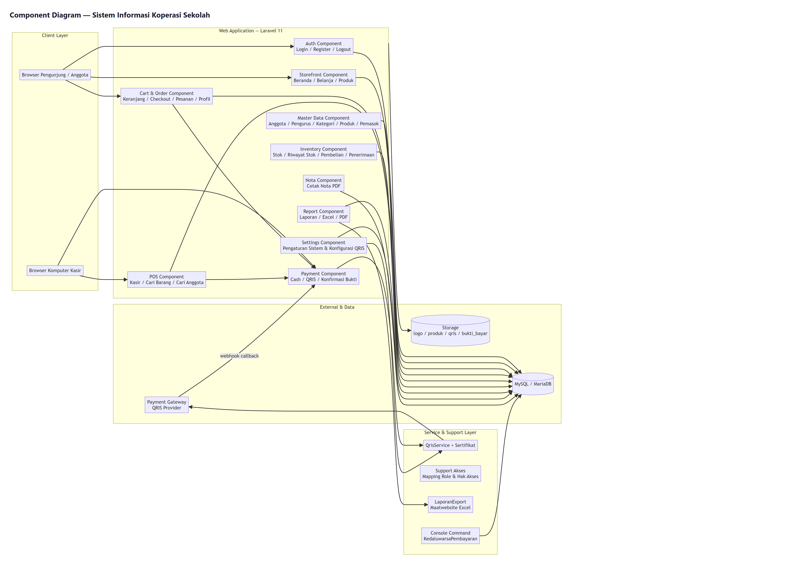

#### A. Deskripsi & Tujuan
Diagram komponen menggambarkan dekomposisi struktural perangkat lunak sistem informasi koperasi ke dalam modul-modul independen yang terikat secara longgar (*loosely coupled*), memperlihatkan antarmuka (*interfaces*), dependensi internal, dan jalur integrasi dengan sistem luar.

#### B. Pembagian Lapisan Komponen
1. **Client Layer (Lapisan Klien)**:
   - `Browser Pengunjung / Anggota`: Peramban pada perangkat siswa/guru/publik untuk mengakses storefront (katalog, keranjang, checkout, pesanan).
   - `Browser Komputer Kasir`: Peramban pada perangkat kasir untuk mengoperasikan POS.
2. **Web Application — Laravel 11 (Lapisan Aplikasi Inti)**:
   - `Auth Component (Login / Register / Logout)`: Autentikasi multi-identitas (Username, NIS, Email), proteksi brute-force RateLimiter, dan pendaftaran anggota mandiri.
   - `Storefront Component (Beranda / Belanja / Produk)`: Tampilan etalase publik, pencarian, dan detail produk.
   - `Cart & Order Component (Keranjang / Checkout / Pesanan / Profil)`: Logika keranjang persisten, checkout, pelacakan status pesanan, unggah bukti bayar, dan profil anggota.
   - `POS Component (Kasir / Cari Barang / Cari Anggota)`: Antarmuka kasir cepat dengan pencarian barang dan identifikasi pembeli umum/anggota.
   - `Payment Component (Cash / QRIS / Konfirmasi Bukti)`: Pemrosesan pembayaran tunai, QRIS dinamis, dan verifikasi bukti pelunasan.
   - `Master Data Component (Anggota / Pengurus / Kategori / Produk / Pemasok)`: Pengelolaan data induk pengguna, kategori barang, produk, dan vendor pemasok.
   - `Inventory Component (Stok / Riwayat Stok / Pembelian / Penerimaan)`: Manajemen stok, audit mutasi (`riwayat_stok`), faktur pembelian, dan konfirmasi penerimaan barang.
   - `Nota Component (Cetak Nota PDF)`: Pembuatan struk thermal 58mm dan unduh nota PDF (DomPDF).
   - `Report Component (Laporan / Excel / PDF)`: Laporan penjualan, laba kotor, terlaris, dan stok dengan ekspor Excel/PDF.
   - `Settings Component (Pengaturan Sistem & Konfigurasi QRIS)`: Konfigurasi identitas koperasi, nomor WhatsApp, provider QRIS, dan masa berlaku tagihan.
3. **Service & Support Layer (Lapisan Layanan Pendukung)**:
   - `QrisService + Sertifikat`: Abstraksi provider QRIS Manual (EMVCo + CRC-16) dan Gateway Midtrans, dilengkapi sertifikat CA TLS (`resources/certificates/midtrans-cacert.pem`).
   - `Support Akses (Mapping Role & Hak Akses)`: Middleware `CekPeran` yang memetakan lima peran ke hak akses menu dan rute.
   - `LaporanExport (Maatwebsite Excel)`: Komponen ekspor lembar kerja Excel untuk laporan.
   - `Console Command KedaluwarsaPembayaran`: Perintah terjadwal `pembayaran:kedaluwarsa` yang membatalkan tagihan QRIS lewat jatuh tempo dan mengembalikan stok.
4. **External & Data Layer (Lapisan Data & Eksternal)**:
   - `MySQL / MariaDB`: Media persistensi data relasional yang menampung 16 tabel transaksional dan 1 SQL View (`v_penjualan_total`).
   - `Storage (logo / produk / qris / bukti_bayar)`: Filesystem lokal untuk foto produk, logo, gambar QR, dan bukti pembayaran.
   - `Payment Gateway QRIS Provider`: Gerbang pembayaran eksternal (opsional, Midtrans Sandbox) yang bertukar data JSON dengan server aplikasi dan mengirim *webhook callback* ke `/api/webhook/qris`.

---

### 3. Deployment Diagram (`03 — Lingkungan Implementasi`)

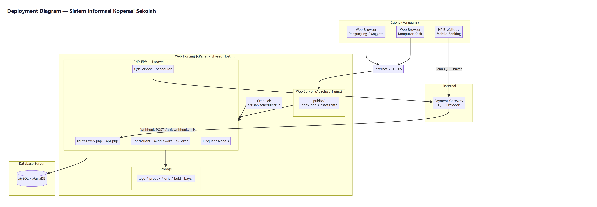

#### A. Deskripsi & Tujuan
Diagram *deployment* memetakan topologi fisik perangkat keras, lingkungan eksekusi perangkat lunak (*runtime environment*), protokol komunikasi antarnode, serta interaksi jaringan eksternal yang dibutuhkan untuk menjalankan sistem secara aman dan andal.

#### B. Node & Konfigurasi Lingkungan
1. **Client Node (Pengguna)**:
   - `Web Browser Pengunjung / Anggota`: Peramban siswa/guru/publik untuk storefront (laptop maupun ponsel).
   - `Web Browser Komputer Kasir`: Peramban pada komputer POS kasir.
   - `HP Mobile Banking / E-Wallet`: Ponsel anggota yang memindai kode QRIS untuk pembayaran.
   - Seluruh klien berkomunikasi dengan server melalui protokol aman terenkripsi **Internet / HTTPS (Port 443)**.
2. **Web Hosting Node (cPanel / Shared Hosting) — PHP-FPM Laravel 11**:
   - `Web Server (Apache / Nginx)`: Reverse proxy, terminasi TLS/SSL, dan penyaji aset statis; mengarahkan request PHP dinamis ke **PHP-FPM**.
   - `public/index.php + assets Vite`: Titik masuk aplikasi Laravel beserta aset frontend hasil kompilasi Vite (CSS/JS).
   - `routes web.php + api.php`: Router aplikasi; rute API publik menyediakan endpoint `Webhook POST /api/webhook/qris`.
   - `Controllers + Middleware CekPeran`: Lapisan orkestrasi request dan otorisasi peran.
   - `Eloquent Models`: Pemetaan ORM ke basis data.
   - `QrisService + Scheduler`: Layanan QRIS dinamis dan penjadwalan; **Cron Job `artisan schedule:run`** berjalan tiap menit untuk memicu `pembayaran:kedaluwarsa`. Pada shared hosting tanpa cron, pembatalan juga dicek saat halaman pembayaran/nota dibuka.
3. **Database Server Node (MySQL / MariaDB)**:
   - Menjalankan instance database dengan mesin InnoDB; terhubung ke Application Server melalui ekstensi native **PDO MySQL** (koneksi internal TCP port 3306). Produksi lokal menggunakan MySQL 8.0.16+.
4. **Storage Node**:
   - Volume penyimpanan berkas lokal (`storage/app/public/`) untuk `logo`, `produk`, `qris`, dan `bukti_bayar`, diekspos publik melalui *symbolic link/junction* `public/storage`.
5. **External Node — Payment Gateway QRIS Provider**:
   - Server pembayaran eksternal (Midtrans Sandbox/Production) dihubungi via REST API keluar untuk pembuatan tagihan QRIS, dan mengirim *webhook callback* masuk ke `/api/webhook/qris` untuk konfirmasi pelunasan.

---

### 4. Entity Relationship Diagram / ERD (`04 — Relasi Basis Data Koperasi`)

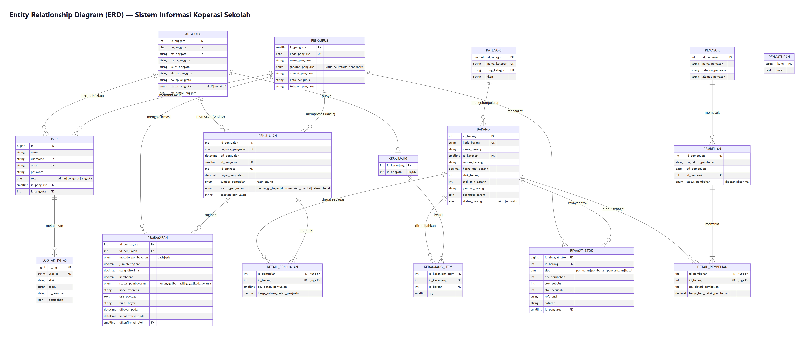

#### A. Deskripsi & Tujuan
Diagram relasi entitas (ERD) menggambarkan arsitektur basis data relasional sistem koperasi sekolah yang terdiri dari 16 tabel terhubung dan 1 SQL View (`v_penjualan_total`). Diagram ini memetakan integritas referensial, aturan kunci primer (*primary key*), kunci tamu (*foreign key*), serta derajat kardinalitas untuk mencegah redundansi dan anomali data.

#### B. Struktur Entitas & Relasi Antartabel
1. **Tabel Pengguna & Akses**:
   - `users`: Menyimpan kredensial otentikasi login (`username`, `email`, `password`, `role` dengan nilai `admin | pengurus | anggota`). Terhubung opsional ke `pengurus` (`id_pengurus`) dan `anggota` (`id_anggota`).
   - `pengurus`: Master profil pengurus (ketua, bendahara, kasir, sekretaris, gudang). Berelasi 1:N ke `penjualan` (kasir pencatat), 1:N ke `pembayaran` (`dikonfirmasi_oleh`), dan 1:N ke `riwayat_stok` (petugas audit opname).
   - `anggota`: Master data siswa/anggota sekolah (`no_anggota`, `nis_anggota`, `nama_anggota`, `kelas_anggota`, `status_anggota` dengan nilai `aktif | nonaktif`). Berelasi 1:1 unik ke `keranjang` dan 1:N ke `penjualan`.
   - `log_aktivitas`: Jejak audit sistem yang mencatat setiap aktivitas operasional (`user_id`, `aksi`, `tabel`, `id_rekaman`, `perubahan`) berelasi N:1 ke `users`.
2. **Tabel Katalog & Inventaris**:
   - `kategori`: Klasifikasi produk (`nama_kategori`, `slug_kategori`, `ikon`). Berelasi 1:N terhadap tabel `barang`.
   - `barang`: Data produk inti (`kode_barang`, `nama_barang`, `harga_jual_barang`, `stok_barang`, `stok_min_barang`, `status_barang`). Menggunakan fitur *Soft Deletes* agar riwayat faktur transaksi tidak terputus ketika produk dinonaktifkan.
   - `riwayat_stok`: Buku log audit perubahan stok fisik (`tipe`: `penjualan | pembelian | penyesuaian | batal`, `qty_perubahan`, `stok_sebelum`, `stok_sesudah`) berelasi N:1 ke `barang` dan N:1 opsional ke `pengurus`.
3. **Tabel Transaksi Penjualan**:
   - `penjualan`: Header bukti transaksi jual-beli (`no_nota_penjualan`, `sumber_penjualan`: `kasir | online`, `status_penjualan`: `menunggu_bayar | diproses | siap_diambil | selesai | batal`). Berelasi 1:N dengan `detail_penjualan` dan 1:N dengan `pembayaran`.
   - `detail_penjualan`: Rincian item barang yang dibeli. Menyimpan `harga_satuan_detail_penjualan` (snapshot harga) untuk menjaga keaslian nilai transaksi masa lampau meskipun harga barang pada tabel master diperbarui di kemudian hari.
   - `pembayaran`: Rekod pelunasan transaksi (`metode_pembayaran`: `cash | qris`, `jumlah_tagihan`, `status_pembayaran`: `menunggu | berhasil | gagal | kedaluwarsa`, `bukti_bayar`, `qris_payload`, `kedaluwarsa_pada`).
4. **Tabel Keranjang Belanja Anggota**:
   - `keranjang`: Wadah belanja daring persisten yang terikat unik pada satu anggota sekolah (`id_anggota UNIQUE`).
   - `keranjang_item`: Menampung item produk sementara dan jumlah barang yang hendak dipesan oleh anggota (`FK id_keranjang`, `FK id_barang`, `qty`).
5. **Tabel Pengadaan Barang (Purchasing)**:
   - `pemasok`: Master data vendor rekanan koperasi (`nama_pemasok`, `telepon_pemasok`, `alamat_pemasok`). Berelasi 1:N ke tabel `pembelian`.
   - `pembelian` & `detail_pembelian`: Faktur transaksi pengadaan stok barang masuk dari pemasok, mencatat harga beli modal (`harga_beli_detail_pembelian`) dan jumlah pasokan; status faktur berubah dari `dipesan` menjadi `diterima` saat barang fisik tiba.
6. **Tabel Konfigurasi**:
   - `pengaturan`: Tabel penyimpanan setelan global sistem berbasis *key-value* (`kunci`, `nilai`), seperti nama instansi, jam operasional, string QRIS statis, dan masa berlaku QRIS (menit).

---

### 5. Sequence Diagram (`05 — Checkout QRIS Anggota`)

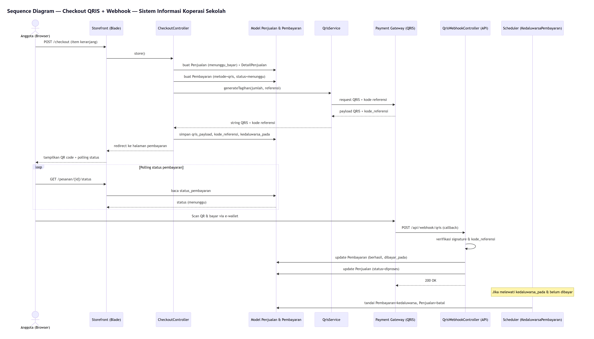

#### A. Deskripsi & Tujuan
Diagram sekuens menggambarkan alur interaksi dan kronologi pengiriman pesan (*message exchange*) secara berurutan antar-komponen sistem pada skenario pemesanan online dengan metode pembayaran QRIS Dinamis. Alur ini menonjolkan penerapan transaksi atomik dan penguncian konkurensi stok.

#### B. Kronologi Tahapan Operasional
Lifeline pada diagram: **Anggota (Browser)** → **Storefront (Blade)** → **CheckoutController** → **Model Penjualan & Pembayaran** → **QrisService** → **Payment Gateway (QRIS)** → **QrisWebhookController (API)**, dengan **Scheduler (KedaluwarsaPembayaran)** di sisi background.

1. **Anggota → Storefront (Blade)**: Siswa memilih item di keranjang, meninjau ringkasan biaya, lalu mengirim `POST /checkout` berisi item keranjang.
2. **Storefront → CheckoutController**: Controller menerima payload melalui method `store()`.
3. **CheckoutController → Model Penjualan & Pembayaran**: Membuat rekod `penjualan` dengan status `menunggu_bayar` beserta `detail_penjualan` (harga snapshot).
4. **CheckoutController → Model**: Membuat rekod `pembayaran` dengan `metode=qris` dan status `menunggu`.
5. **CheckoutController → QrisService**: Memanggil `generateTagihan(jumlah, referensi)` untuk membentuk tagihan QRIS.
6. **QrisService → Payment Gateway (QRIS)**: Mengirim permintaan `request QRIS + kode referensi` (mode gateway); pada mode manual, QrisService menyusun payload EMVCo + checksum CRC-16 secara lokal.
7. **Payment Gateway → QrisService**: Mengembalikan `payload QRIS + kode referensi`.
8. **QrisService → CheckoutController**: Mengembalikan `string QRIS + kode referensi`.
9. **CheckoutController → Model**: Menyimpan `qris_payload`, `kode_referensi`, dan `kedaluwarsa_pada` (default 15 menit) ke tabel `pembayaran`.
10. **CheckoutController → Storefront**: Melakukan *redirect* ke halaman pembayaran.
11. **Storefront → Anggota**: Menampilkan kode QR dinamis beserta *timer*; anggota memantau status melalui polling `GET /pesanan/{id}/status` yang membaca `status_pembayaran` (awal: `menunggu`).
12. **Anggota → Payment Gateway**: Memindai QR dan membayar melalui aplikasi *mobile banking* atau *e-wallet*.
13. **Payment Gateway → QrisWebhookController (API)**: Mengirim callback `POST /api/webhook/qris`; controller memverifikasi *signature* dan `kode_referensi`, lalu memperbarui `pembayaran` menjadi `berhasil` (terisi `dibayar_pada`) dan `penjualan` menjadi `diproses`, kemudian membalas `200 OK`.
14. **Scheduler (KedaluwarsaPembayaran)**: Jika tagihan melewati `kedaluwarsa_pada` dan belum dibayar, scheduler menandai `pembayaran = kedaluwarsa` dan `penjualan = batal`, serta mengembalikan stok yang dicadangkan.

> Catatan implementasi: seluruh langkah penyimpanan transaksi dibungkus `DB::transaction` (atomik, ACID) dengan penguncian baris `lockForUpdate` (*pessimistic lock*) pada tabel `barang`; item diurutkan berdasarkan ID barang untuk mencegah *deadlock*. Jika pembuatan QRIS gagal, seluruh transaksi di-*rollback*.

---

### 6. System Architecture Diagram (`06 — Arsitektur Sistem`)

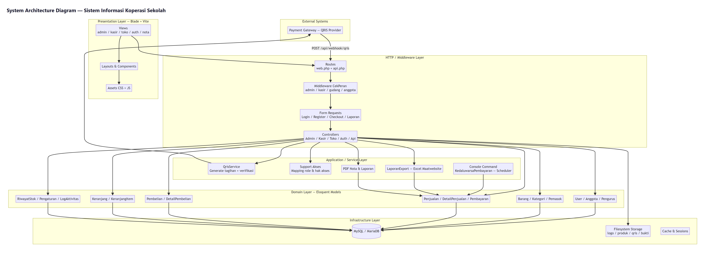

#### A. Deskripsi & Tujuan
Diagram arsitektur sistem memberikan gambaran menyeluruh mengenai desain hierarki tingkat tinggi (*high-level system design*) yang diterapkan pada sistem informasi koperasi. Struktur ini mengimplementasikan pola **Arsitektur Berlapis (Layered Architecture)** untuk memisahkan tanggung jawab sistem (*separation of concerns*) secara tegas.

#### B. Rincian Arsitektur 4 Lapisan
1. **Lapisan Aktor & Kanal (Actors & Channels)**:
   - Mengelompokkan seluruh entitas pemakai sistem: Pengunjung Publik, Anggota (Siswa/Guru), Kasir/Bendahara, Gudang/Sekretaris, dan Admin/Ketua Koperasi.
2. **Presentation Layer (Blade & Alpine.js)**:
   - **Back Office**: Panel kontrol operasional bagi admin dan staf gudang untuk mengakses metrik dashboard, mengelola data anggota & pengurus, menerbitkan laporan akuntansi, dan memproses stok opname.
   - **POS Kasir**: Aplikasi kasir toko fisik terisolasi yang dioptimasi untuk kecepatan pelayanan transaksi tunai/nontunai langsung.
   - **Storefront**: Portal toko daring swalayan untuk penelusuran katalog etalase, keranjang belanja dinamis, dan pemesanan online mandiri.
3. **Application Layer (Laravel 11)**:
   - **Authentication + Middleware Peran**: Mengamankan titik masuk aplikasi dengan pembatasan hak akses berbasis peran terverifikasi (`CekPeran`).
   - **Controllers & Services**: Otak pemroses logika sistem yang mengendalikan alur checkout, pemotongan stok berintegritas tinggi, pengelolaan penjualan, dan format struk belanja.
   - **Integrasi**: Modul penghubung pustaka eksternal untuk generator string QRIS standar EMVCo (CRC-16), engine pencetakan dokumen PDF (DomPDF), dan generator berkas lembar kerja Excel (Maatwebsite Excel).
4. **Data & Runtime Layer**:
   - **Midtrans Opsional (Core API + Webhook)**: Modul gerbang pembayaran eksternal untuk verifikasi otomatis status pelunasan transaksi secara daring.
   - **Scheduler**: Daemon background Laravel (`pembayaran:kedaluwarsa`) yang mengotomasi pembatalan transaksi QRIS yang melewati batas waktu kedaluwarsa.
   - **Storage**: Media penyimpanan berkas publik (foto produk, bukti bayar, logo) yang tersimpan aman pada direktori lokal server.
   - **MySQL 8+**: RDBMS utama penyimpan 16 tabel relasional terindeks serta SQL View laporan total transaksi (`v_penjualan_total`).

---

### 7. Use Case Diagram (`07 — Fitur per Peran`)

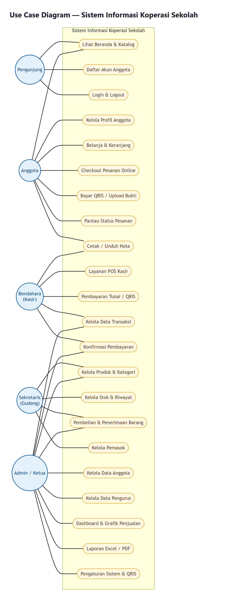

#### A. Deskripsi & Tujuan
Diagram use case memetakan interaksi fungsional antara aktor pengguna dengan sistem informasi koperasi sekolah, mendefinisikan batasan sistem (*system boundary*), serta menegaskan pembagian hak akses fitur (*Role-Based Access Control*).

#### B. Matriks Aktor & Fungsionalitas Use Case
1. **Pengunjung (Publik Tanpa Login)**:
   - `Lihat Beranda & Katalog`: Menjelajahi etalase produk, melihat harga jual, dan memeriksa sisa stok fisik.
   - `Daftar Akun Anggota`: Mendaftar sebagai anggota koperasi siswa baru secara mandiri.
   - `Login & Logout`: Masuk ke akun yang sudah terdaftar dan keluar dari sesi.
2. **Anggota (Siswa & Guru Terdaftar)**:
   - Mengakses seluruh kapabilitas Pengunjung, ditambah:
   - `Kelola Profil Anggota`: Memperbarui data diri dan foto profil anggota.
   - `Belanja & Keranjang`: Menambah, mengubah kuantitas, atau menghapus barang belanjaan di keranjang belanja daring.
   - `Checkout Pesanan Online`: Memproses pesanan barang dengan pilihan pembayaran Cash atau QRIS.
   - `Bayar QRIS / Upload Bukti`: Melakukan pembayaran QRIS dan mengunggah berkas foto bukti transaksi.
   - `Pantau Status Pesanan`: Memantau status pesanan (`menunggu_bayar` → `diproses` → `siap_diambil` → `selesai`, atau `batal`) dan meninjau histori transaksi belanja sebelumnya.
   - `Cetak / Unduh Nota`: Melihat dan mengunduh nota transaksi dalam format PDF.
3. **Bendahara (Kasir)**:
   - `Layanan POS Kasir`: Mengoperasikan antarmuka Point of Sale kasir untuk transaksi langsung di toko, menghitung kembalian tunai, dan mencetak nota struk thermal 58mm.
   - `Pembayaran Tunai / QRIS`: Mencatat pelunasan tunai langsung maupun pembayaran QRIS di kasir.
   - `Kelola Data Transaksi`: Melihat rincian transaksi, memproses pesanan online (siap diambil → selesai), dan membatalkan transaksi.
   - `Konfirmasi Pembayaran`: Memvalidasi pelunasan bukti QRIS yang masuk dari anggota.
4. **Sekretaris (Gudang)**:
   - `Kelola Produk & Kategori`: Mengelola master data barang, foto produk, penetapan stok minimum, serta klasifikasi kategori.
   - `Kelola Stok & Riwayat`: Melakukan audit penyesuaian stok opname manual disertai alasan tertulis dan memantau log mutasi persediaan.
   - `Pembelian & Penerimaan Barang`: Mencatat faktur pengadaan ke pemasok dan mengonfirmasi penerimaan barang saat tiba (stok bertambah otomatis).
   - `Kelola Pemasok`: Mengelola master vendor pemasok beserta kontak dan alamatnya.
5. **Admin / Ketua Koperasi**:
   - Berperan sebagai *Superuser* dengan hak kendali penuh terhadap seluruh use case di atas, ditambah hak istimewa:
   - `Kelola Data Anggota` dan `Kelola Data Pengurus`: Mengelola data induk keanggotaan siswa serta akun dan jabatan staf pengurus (termasuk laporan PDF).
   - `Dashboard & Grafik Penjualan`: Memantau metrik omzet, pesanan, produk, anggota, dan grafik tren penjualan.
   - `Laporan Excel / PDF`: Mengakses analisis penjualan harian/bulanan, laba kotor, barang terlaris, mutasi stok, dan mengunduh laporan ke format Excel atau PDF.
   - `Pengaturan Sistem & QRIS`: Mengatur identitas koperasi, nomor WhatsApp toko, parameter QRIS (provider manual/gateway, masa berlaku), dan konfigurasi sistem lainnya.


### 8. Matriks Audit Hak Akses

Bagian ini memuat dokumentasi visual **Matriks Audit Hak Akses** untuk Sistem Informasi Koperasi Sekolah SMP Negeri 2 Metro. Gambar disimpan pada direktori `matriks/` di repository.

| Halaman | Dokumentasi |
| :---: | :--- |
| 1 | [Lihat gambar halaman 1](matriks/matriks-audit-hak-akses-halaman-1.png) |
| 2 | [Lihat gambar halaman 2](matriks/matriks-audit-hak-akses-halaman-2.png) |
| 3 | [Lihat gambar halaman 3](matriks/matriks-audit-hak-akses-halaman-3.png) |
| 4 | [Lihat gambar halaman 4](matriks/matriks-audit-hak-akses-halaman-4.png) |
| 5 | [Lihat gambar halaman 5](matriks/matriks-audit-hak-akses-halaman-5.png) |

#### Halaman 1
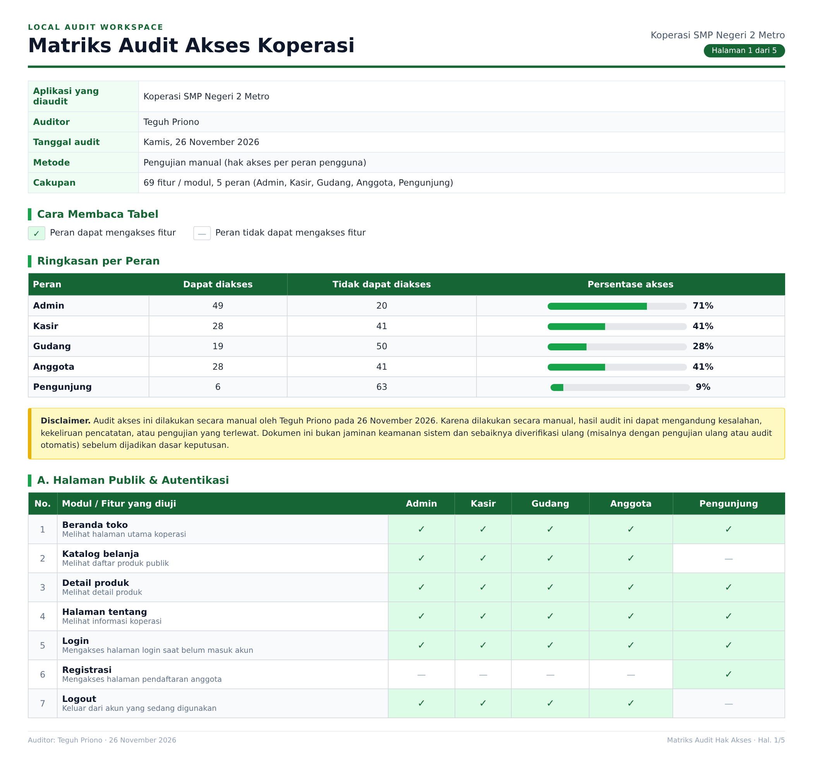

#### Halaman 2
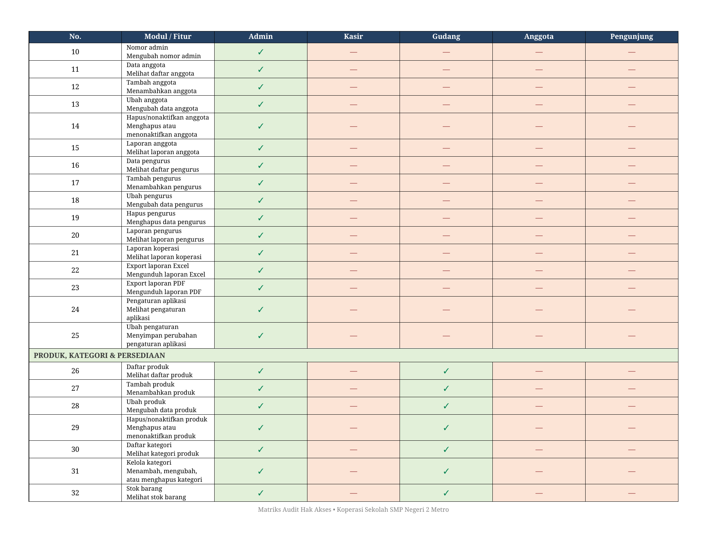

#### Halaman 3
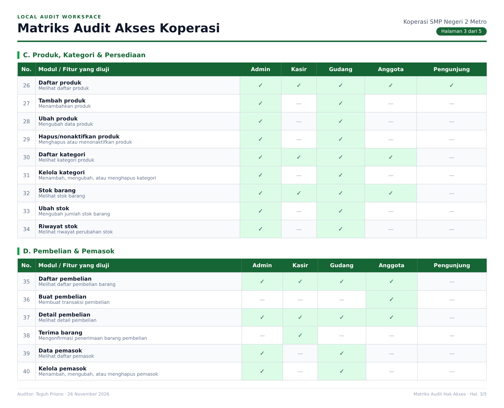

#### Halaman 4
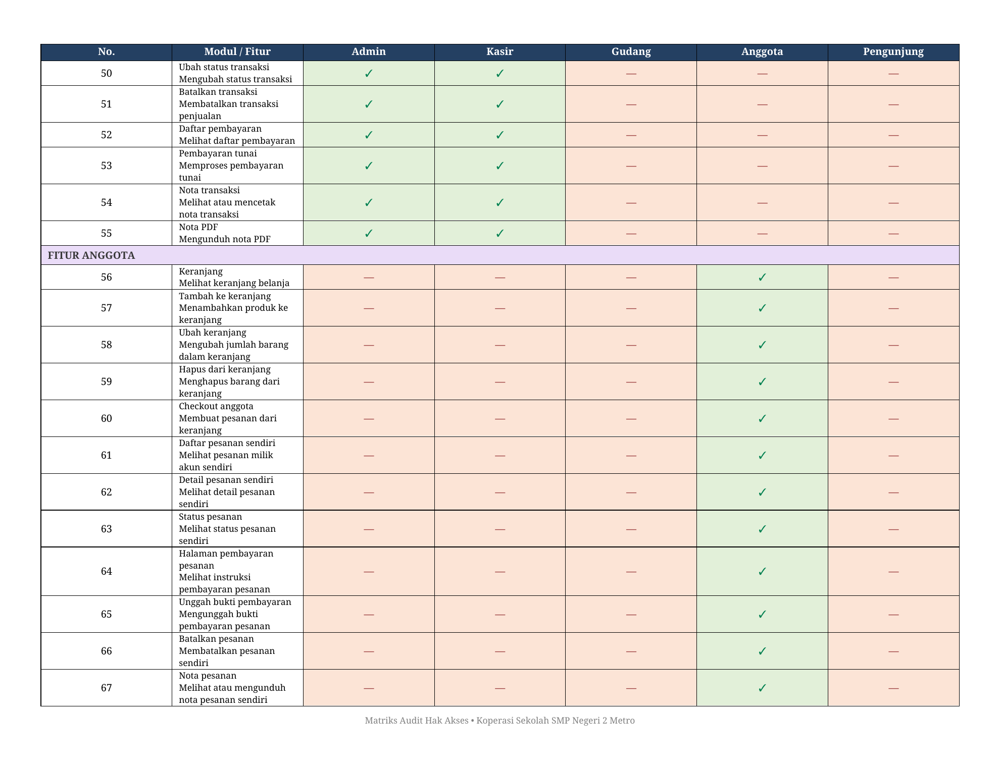

#### Halaman 5
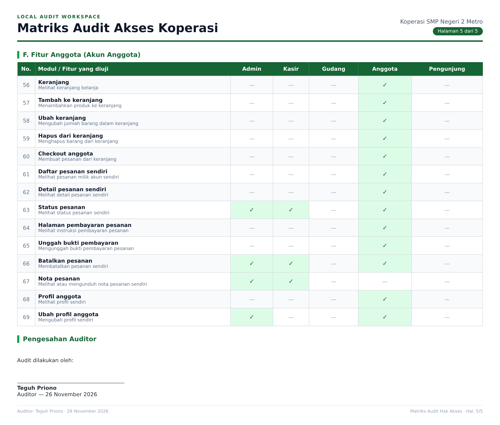

[](https://1drv.ms/w/c/b38f5ac96655c76b/IQDU-w6q-dSTS4Cpgu0YTyntAcifz43V47V-G4y5oA1Tu8A?e=BEci5d)
---

## D. Tentang Aplikasi

### 1. Latar Belakang
Koperasi Sekolah SMP Negeri 2 Metro merupakan unit penunjang utama dalam memenuhi kebutuhan perlengkapan belajar mengajar siswa, seragam sekolah, merchandise resmi, alat tulis kantor (ATK), dan konsumsi harian. Pengelolaan operasional yang sebelumnya berjalan konvensional menggunakan pembukuan kertas sering menghadapi kendala selisih stok fisik, antrean panjang di kasir pada jam istirahat, serta lamanya proses rekonsiliasi laporan keuangan bulanan.

### 2. Tujuan Pengembangan
Aplikasi ini dikembangkan untuk mendigitalkan seluruh ekosistem transaksi koperasi sekolah, meliputi:
- **Transparansi & Akurasi**: Menghilangkan selisih stok dan kesalahan pencatatan transaksi melalui *transactional integrity* berbasis database ACID.
- **Efisiensi Transaksi Kasir**: Mempercepat layanan kasir langsung dengan antarmuka POS modern dan pencetakan struk termal 58mm instan.
- **Kemudahan Akses Siswa**: Membuka saluran pemesanan online bagi anggota sekolah (siswa & guru) untuk memesan barang dari ruang kelas atau rumah dan mengambilnya di koperasi tanpa mengantre.
- **Akuntabilitas Keuangan**: Menyediakan laporan penjualan, laba kotor, dan valuasi aset barang secara otomatis yang dapat diunduh dalam format Excel dan PDF.

### 3. Pengguna Aplikasi
Aplikasi ini dirancang untuk melayani 5 kelompok pengguna dengan pembagian hak akses terisolasi (*Role-Based Access Control*):
1. **Admin / Ketua Koperasi**: Memantau metrik bisnis, master data anggota & pengurus, laporan laba rugi, dan konfigurasi sistem.
2. **Kasir / Bendahara**: Melayani transaksi POS langsung, mengonfirmasi pelunasan cash/QRIS, dan mencetak nota pembayaran.
3. **Gudang / Sekretaris**: Mengelola katalog barang, kategori, stok opname, serta pembelian dan penerimaan barang dari pemasok.
4. **Anggota / Siswa**: Mengakses storefront belanja daring, keranjang belanja, checkout nontunai QRIS, dan riwayat pesanan.
5. **Pengunjung / Publik**: Menjelajahi etalase produk, mengecek jam layanan koperasi, dan melakukan pendaftaran anggota baru secara mandiri.

---

## E. Fitur Aplikasi

Sistem Koperasi Sekolah SMP Negeri 2 Metro mengimplementasikan fitur-fitur berikut berdasarkan arsitektur kode sumber aktual:

### 1. Autentikasi & Keamanan Pengguna
- **Multi-Identifier Login**: Pengguna dapat masuk menggunakan Username, Nomor Induk Siswa (NIS), atau Email.
- **Proteksi Brute Force**: Proteksi `RateLimiter` maksimal 5 kali percobaan gagal per kombinasi identitas + alamat IP sebelum login diblokir sementara.
- **Registrasi Mandiri Siswa**: Form pendaftaran anggota otomatis men-generate Nomor Anggota urut (`A00001`, `A00002`, dst.) dan akun login siswa (username = NIS) dalam satu transaksi database atomik.
- **Pengecekan Status Aktif**: Siswa dengan status keanggotaan nonaktif dicegah masuk ke sistem secara otomatis.

### 2. Point of Sale (POS Kasir)
- **Pencarian Cepat Berbasis AJAX**: Menampilkan katalog barang aktif lengkap dengan kode, harga, dan sisa stok secara instan.
- **Fleksibilitas Pelanggan**: Mendukung transaksi untuk anggota sekolah terdaftar (tercatat di riwayat belanja siswa) maupun pelanggan umum (*guest shopper*).
- **Pembayaran Multi-Metode**: Pilihan pembayaran Tunai (Cash) dengan kalkulator uang diterima & kembalian, atau pembayaran QRIS Dinamis.
- **Cetak Struk Thermal & PDF**: Format nota disesuaikan khusus untuk printer kasir thermal standar 58mm serta opsi unduh berkas PDF melalui DomPDF.

### 3. Toko Online Anggota (*Storefront*)
- **Keranjang Belanja Persisten**: Disimpan pada basis data (`keranjang` & `keranjang_item`) sehingga keranjang belanja anggota tidak hilang saat berganti perangkat.
- **Checkout Selektif**: Anggota dapat memilih sebagian atau seluruh item di keranjang untuk diproses dalam satu pesanan.
- **Pelacakan Siklus Pesanan**: Status pesanan terpantau secara transparan: `menunggu_bayar` → `diproses` → `siap_diambil` → `selesai` (atau `batal`).
- **Unggah Bukti Pembayaran**: Fasilitas unggah foto bukti transfer/struk QRIS bagi anggota untuk mempermudah verifikasi oleh pengurus.

### 4. Manajemen Inventaris & Mutasi Stok
- **Master Data Produk & Kategori**: Manajemen produk lengkap dengan satuan barang, batas minimum stok, foto produk, dan fitur *Soft Deletes* (data historis transaksi tidak rusak saat barang dihapus).
- **Row-Locking Concurrency Control**: Pemotongan stok saat checkout menggunakan kueri `lockForUpdate` dengan pengurutan ID barang untuk mengeliminasi risiko *race condition* dan *deadlock*.
- **Audit Mutasi Stok Permanen (`riwayat_stok`)**: Setiap penambahan (pembelian), pengurangan (penjualan), pembatalan, dan stok opname tercatat otomatis lengkap dengan kuantitas sebelum, perubahan, dan sesudah.
- **Penyesuaian Stok (Stok Opname)**: Fitur penyesuaian stok manual yang mewajibkan input alasan tertulis dan mencatat petugas pengurus yang melakukan perubahan.

### 5. Pengadaan & Pembelian dari Pemasok
- **Pencatatan Faktur Pemasok**: Pembuatan order pengadaan barang ke pemasok luar dengan status awal `dipesan` (stok belum bertambah).
- **Konfirmasi Penerimaan Barang**: Tombol konfirmasi saat barang fisik tiba di sekolah yang secara otomatis menambah stok fisik dan mencatat mutasi masuk ke `riwayat_stok`.
- **Master Data Pemasok**: Manajemen data vendor, nomor telepon, dan alamat pemasok.

### 6. Sistem Pembayaran QRIS (Manual & Gateway)
- **Mode Manual (Default)**: Mengubah string QRIS statis koperasi menjadi QRIS dinamis ber-tagihan spesifik menggunakan algoritma standar EMVCo dengan kalkulasi checksum CRC-16 CCITT.
- **Mode Gateway (Midtrans Sandbox)**: Terintegrasi dengan endpoint API Midtrans untuk menghasilkan QRIS secara otomatis dan menerima notifikasi pelunasan via webhook di `/api/webhook/qris` (verifikasi signature, idempoten).
- **Sistem Kedaluwarsa Otomatis**: Transaksi QRIS memiliki masa berlaku (default 15 menit, dapat diatur di pengaturan). Perintah terjadwal `pembayaran:kedaluwarsa` secara otomatis membatalkan pesanan yang lewat batas waktu dan mengembalikan stok barang ke etalase.

### 7. Laporan Keuangan & Ekspor
- **Jenis Laporan**: Penjualan Harian, Penjualan Bulanan, Per Metode Bayar, Barang Terlaris, Laba Kotor (HPP harga beli terakhir × terjual), dan Posisi Stok (nilai persediaan).
- **Filter Fleksibel**: Laporan dapat disaring berdasarkan rentang tanggal kustom.
- **Ekspor Excel (.xlsx)**: Menggunakan Maatwebsite Excel untuk analisis pembukuan tingkat lanjut.
- **Cetak Laporan PDF**: Dokumen cetak resmi berukuran A4 (portrait/landscape) lengkap dengan kop identitas koperasi dan tanda tangan pengurus.

---

## F. Teknologi & Dependensi

| Kategori | Teknologi / Pustaka | Versi | Fungsi dalam Sistem |
| :--- | :--- | :---: | :--- |
| **Backend Framework** | Laravel Framework | `^11.31` | Kerangka kerja MVC utama, routing, middleware, dan service container. |
| **Bahasa Pemrograman** | PHP | `^8.2` | Bahasa pemrograman sisi server dengan tipe data ketat (*strict types*). |
| **Basis Data** | MySQL Database | `^8.0.16` | Engine InnoDB, relational constraints, foreign keys, dan SQL View `v_penjualan_total`. |
| **Styling & Desain** | Tailwind CSS | `^3.4.13` | Utility-first CSS framework untuk antarmuka responsif dan modern. |
| **Frontend Scripting** | Alpine.js | `^3.17.5` | Reaktivitas DOM ringan untuk POS kasir, keranjang belanja, dan modal dialog. |
| **Visualisasi Data** | Chart.js | `^4.5.1` | Render grafik garis performa omzet penjualan pada dashboard admin. |
| **QR Code Engine** | qrcode (npm) | `^1.5.4` | Render grafis QR Code dari string EMVCo QRIS di sisi browser. |
| **Build Tooling** | Vite | `^6.0.11` | Kompilasi aset frontend super cepat dengan modul PostCSS & Autoprefixer. |
| **Dokumen PDF** | Barryvdh Laravel DomPDF | `^3.1` | Render struk thermal kasir 58mm dan laporan cetak akuntansi A4. |
| **Dokumen Spreadsheet** | Maatwebsite Excel | `^1.1` | Ekspor tabel laporan rekap penjualan ke format Microsoft Excel (.xlsx). |
| **Payment Gateway** | Midtrans HTTP Client | Sandboxed | Integrasi pembayaran QRIS dinamis via API Midtrans Sandbox. |

---

## G. Ringkasan Arsitektur Sistem

Aplikasi dibangun dengan pola **Layered Architecture** yang memisahkan tanggung jawab sistem secara tegas:

```
[ Web Browser / Client Devices ]
          │ (HTTP/HTTPS Requests)
          ▼
  [ Routing & Middleware ]
 (routes/web.php, api.php & CekPeran)
          │
          ▼
       [ Controllers ]
 (HTTP Dispatchers & Validations)
          │
          ▼
   [ Service Layer ]  ◄── (Business Logic, Transactions, & Concurrency Locks)
 (Checkout, Stok, Pembayaran, Penjualan, Pembelian, Laporan)
          │
      ┌───┴───────┐
      ▼           ▼
 [ Eloquent ]  [ Storage ]
  (Models)      (Public Files)
      │
      ▼
  [ MySQL 8.0+ ]
   (InnoDB Engine)
```

Untuk visualisasi arsitektur dan dokumentasi diagram sistem lengkap, silakan lihat [Bagian C. Dokumentasi Diagram Sistem](#c-dokumentasi-diagram-sistem).

---

## H. Struktur Direktori Repository

```
koperasi/
├── app/
│   ├── Console/Commands/          # Scheduled command (pembayaran:kedaluwarsa)
│   ├── Exceptions/                # Domain exceptions (StokTidakCukup, UangKurang, QrisBelumDiatur)
│   ├── Exports/                   # Template ekspor Excel (LaporanExport)
│   ├── Http/
│   │   ├── Controllers/
│   │   │   ├── Admin/             # Controller dashboard, produk, kategori, stok, pembelian, laporan, dll.
│   │   │   ├── Api/               # Webhook endpoint (QrisWebhookController)
│   │   │   ├── Auth/              # LoginController & RegisterController
│   │   │   ├── Kasir/             # PosController & Kasir\PembayaranController
│   │   │   └── Toko/              # Beranda, Belanja, Keranjang, Checkout, Pesanan, Profil
│   │   ├── Middleware/            # Otorisasi peran (CekPeran, alias route: peran)
│   │   └── Requests/              # Form request validation classes
│   ├── Models/                    # 16 Eloquent models (User, Barang, Penjualan, Pembelian, dll.)
│   ├── Providers/                 # Service providers (AppServiceProvider, QrisServiceProvider)
│   ├── Services/                  # Business logic services (Checkout, Stok, Pembayaran, dll.)
│   │   └── Qris/                  # Provider QRIS (ManualQrisProvider, GatewayQrisProvider, QrisCrc16)
│   └── Support/                   # Helper fungsional (Akses, HalamanAwal, FormatLaporan, Rupiah, dll.)
├── config/                       # Konfigurasi aplikasi (koperasi, qris, database, dll.)
├── database/
│   ├── migrations/                # 14 migrasi domain (16 tabel) + view v_penjualan_total + migrasi bawaan framework
│   └── seeders/                   # Data inisialisasi awal (User, Pengurus, Anggota, Barang, dll.)
├── laporan/
│   ├── 7-diagram-koperasi-PNG/    # 7 diagram sistem (PNG) + folder sumber-mmd/ (file .mmd Mermaid)
│   └── screenshots/                # 5 berkas tangkapan layar antarmuka asli
├── public/                        # Web server entry point (index.php, .htaccess, storage symlink)
│   ├── images/                    # Aset gambar statis, ikon kategori produk, dan metode bayar
│   └── storage/                    # Junction/symlink ke direktori storage/app/public
├── resources/
│   ├── certificates/              # Sertifikat CA resmi Midtrans (midtrans-cacert.pem)
│   ├── css/                       # Sumber styling Tailwind CSS (app.css)
│   ├── js/                        # Script antarmuka (admin, pos, gudang, app)
│   └── views/                     # Template Blade (admin, auth, kasir, nota, toko, components)
├── routes/                        # Definisi rute (web.php, api.php, console.php)
├── storage/app/public/            # Berkas dinamis (foto produk, logo, bukti bayar)
├── .env.example                   # Contoh konfigurasi lingkungan
├── composer.json / composer.lock
├── package.json / package-lock.json
└── vite.config.js / tailwind.config.js / postcss.config.js
```

---

## I. Panduan Instalasi Lokal

Ikuti langkah-langkah berikut untuk menjalankan aplikasi di lingkungan pengembangan lokal:

### 1. Prasyarat Sistem
- **PHP**: Versi `8.2.0` atau lebih baru (disarankan `8.3.x`) dengan ekstensi: `pdo_mysql`, `mbstring`, `openssl`, `tokenizer`, `xml`, `ctype`, `json`, `bcmath`, `fileinfo`, `gd`, `zip`, `curl`.
- **Composer**: Versi `2.x`.
- **Node.js**: Versi `18.x` atau `20.x` LTS dan `npm`.
- **Basis Data**: **MySQL 8.0.16+** (wajib versi 8.0.16 ke atas karena menggunakan klausa `CHECK` constraints dan `CREATE OR REPLACE VIEW`).

### 2. Kloning Repository & Instalasi Dependensi
```bash
# 1. Kloning repository
git clone https://github.com/teguhsibersec/sistem-informasi-koperasi.git
cd sistem-informasi-koperasi

# 2. Instal dependensi PHP (Composer)
composer install

# 3. Instal dependensi Frontend (NPM)
npm install
```

### 3. Konfigurasi Lingkungan (`.env`)
Salin berkas contoh konfigurasi lingkungan:
```bash
cp .env.example .env
```
Buka berkas `.env` dan sesuaikan kredensial koneksi MySQL Anda:
```dotenv
APP_NAME="Koperasi Sekolah SMP Negeri 2 Metro"
APP_ENV=local
APP_KEY=
APP_DEBUG=true
APP_URL=http://127.0.0.1:8000
APP_TIMEZONE=Asia/Jakarta

KOPERASI_NAMA="KOPERASI SEKOLAH SMP NEGERI 2 METRO"
KOPERASI_SUBJUDUL="Aplikasi Pengolahan Data Koperasi Sekolah SMP Negeri 2 Metro"
KOPERASI_ALAMAT="Metro, Lampung"

DB_CONNECTION=mysql
DB_HOST=127.0.0.1
DB_PORT=3306
DB_DATABASE=koperasi
DB_USERNAME=root
DB_PASSWORD=

# Konfigurasi Provider QRIS (kosongkan untuk memilih lewat menu Pengaturan; manual | gateway)
QRIS_PROVIDER=
MIDTRANS_SERVER_KEY=
MIDTRANS_IS_PRODUCTION=false
MIDTRANS_BASE_URL=https://api.sandbox.midtrans.com
```

Generate application encryption key:
```bash
php artisan key:generate
```

### 4. Persiapan Basis Data & Seeding
Pastikan database dengan nama `koperasi` sudah dibuat di server MySQL Anda:
```sql
CREATE DATABASE koperasi CHARACTER SET utf8mb4 COLLATE utf8mb4_unicode_ci;
```
Jalankan migrasi tabel beserta data awal (*seeders*):
```bash
php artisan migrate:fresh --seed
```

### 5. Konfigurasi Penyimpanan Berkas (*Storage Link*)
Hubungkan direktori publik ke storage berkas:
```bash
php artisan storage:link
```
*(Catatan Pengguna Windows: Jika symlink terhambat hak akses Administrator, buat direktori junction menggunakan perintah: `cmd /c mklink /J public\storage storage\app\public`)*.

### 6. Kompilasi Aset & Menjalankan Server
Jalankan development server dan kompilasi aset frontend:
```bash
# Terminal 1: Menjalankan Laravel Development Server
php artisan serve

# Terminal 2: Menjalankan Vite Asset Bundler
npm run dev

# Terminal 3: Menjalankan Scheduler (Otomasi Kedaluwarsa QRIS tiap menit)
php artisan schedule:work
```
Aplikasi kini dapat diakses melalui peramban web di alamat: **`http://127.0.0.1:8000`**.
*(Tanpa jalur `npm run dev`, jalankan `npm run build` sekali saja untuk mengompilasi aset produksi.)*

### 7. Kredensial Akun Bawaan (*Demo Accounts*)
Seluruh akun seeder menggunakan password default: **`password`**

| Peran Pengguna | Username / Login | Password | Halaman Arahan Awal | Akses Menu Utama |
| :--- | :--- | :--- | :--- | :--- |
| **Administrator** | `admin` | `password` | `/admin` | Dashboard, seluruh menu admin, master data, laporan, dan pengaturan. |
| **Kasir / Bendahara** | `kasir` | `password` | `/kasir` | Kasir Point of Sale (POS), pembayaran, transaksi, dan cetak nota. |
| **Gudang / Sekretaris** | `gudang` | `password` | `/admin/produk` | Produk, Kategori, Stok Barang (riwayat & opname), Pembelian/Pemasok. |
| **Anggota / Siswa** | `anggota` / NIS `2201000001` | `password` | `/` | Storefront belanja online, keranjang, pesanan saya, profil. |

> Anggota juga dapat login menggunakan alamat email terdaftar. Pengunjung dapat menjelajahi katalog tanpa login, dan calon anggota baru dapat mendaftar mandiri melalui tautan **Daftar sebagai anggota** di halaman login.

---

## J. Informasi Deployment

### 1. Lingkungan Terverifikasi (On-Premise / Standar VPS)
Aplikasi terverifikasi stabil dijalankan pada server fisik (*on-premise*) atau Virtual Private Server (VPS) berspesifikasi:
- OS: Ubuntu Server 22.04 LTS / Debian 12 / Windows Server.
- Web Server: Nginx (dengan PHP-FPM) atau Apache (dengan modul `mod_rewrite`).
- Database: MySQL Server 8.0.16+.
- Process Manager: Supervisor untuk menjaga proses `schedule:work` dan `queue:listen` tetap aktif di latar belakang.

### 2. Hosting Shared (InfinityFree / cPanel)
Aplikasi juga diuji berjalan pada hosting shared InfinityFree (PHP 8.2/8.3) dengan installer `install.php` otomatis (cek PHP, koneksi DB, migrasi, seeding, dan pembersihan cache). Catatan khusus lingkungan shared:
- **Cron job tidak tersedia** pada paket gratis InfinityFree; pembatalan QRIS kedaluwarsa tetap diperiksa saat halaman pembayaran/nota dibuka. Untuk otomatisasi penuh, daftarkan cron eksternal gratis (mis. cron-job.org) yang memanggil `php artisan pembayaran:kedaluwarsa` atau route terjadwal setiap menit.
- Pastikan ekstensi PHP `pdo_mysql`, `mbstring`, `openssl`, `tokenizer`, `xml`, `ctype`, `json`, `fileinfo`, `curl`, `gd`, dan `zip` aktif.
- Berkas `.env` dilindungi oleh `.htaccess` agar tidak dapat diakses publik.

### 3. Aplikasi Hosted / Deployment Publik

Aplikasi Koperasi Sekolah SMP Negeri 2 Metro telah di-hosting dan tersedia melalui alamat publik berikut:

| Informasi | Detail |
| :--- | :--- |
| **Nama Aplikasi** | Koperasi Sekolah SMP Negeri 2 Metro |
| **URL Website** | [https://koperasi-teguh.freedev.app/](https://koperasi-teguh.freedev.app/) |
| **Akses** | Online melalui browser |

> **Catatan:** Tautan di atas merupakan alamat aplikasi yang disediakan untuk mengakses versi hosted. Konfigurasi internal layanan hosting, seperti spesifikasi server, lokasi database, dan mekanisme penyimpanan berkas, tidak dirinci di README ini.

---

## K. Informasi Pengembang

Proyek Sistem Informasi Koperasi Sekolah SMP Negeri 2 Metro dikembangkan oleh mahasiswa Universitas Muhammadiyah Metro sebagai bagian dari pengembangan dan implementasi sistem informasi berbasis web.

**Identitas Pengembang**

| Keterangan | Informasi |
|---|---|
| Nama Lengkap | Teguh Priono |
| NPM | 24430018 |
| Program Studi | Ilmu Komputer |
| Institusi | Universitas Muhammadiyah Metro |
| GitHub | [@teguhsibersec](https://github.com/teguhsibersec) |
| Repository | [sistem-informasi-koperasi](https://github.com/teguhsibersec/sistem-informasi-koperasi) |
| Lisensi | MIT License |

**Pengembang Utama:** Teguh Priono

---

## L. Panduan Unggah ke GitHub

Agar README ini langsung tampil sempurna (termasuk seluruh screenshot dan diagram) setelah di-*push*, ikuti langkah berikut:

### 1. Struktur yang Wajib Ikut Ter-Commit
Pastikan di root repository terdapat:
- `README.md` (berkas ini)
- Folder `laporan/screenshots/` (5 file PNG screenshot)
- Folder `laporan/7-diagram-koperasi-PNG/` (7 file PNG diagram + folder `sumber-mmd/`)

### 2. Berkas yang Diabaikan (sudah diatur di `.gitignore`)
Jangan ikut di-*commit*: `/vendor`, `/node_modules`, `/public/build`, `.env`, dan `public/storage` (symlink/junction). Pengguna hasil clone cukup menjalankan `composer install`, `npm install`, `php artisan key:generate`, `php artisan migrate:fresh --seed`, dan `php artisan storage:link`.

### 3. Perintah Git
```bash
# Dari root folder proyek (folder yang berisi file artisan dan folder app/)
git init
git add .
git commit -m "Initial commit: Sistem Informasi Koperasi SMP Negeri 2 Metro (Laravel 11)"
git branch -M main
git remote add origin https://github.com/teguhsibersec/sistem-informasi-koperasi.git
git push -u origin main
```

### 4. Checklist Sebelum Push
- [ ] Semua 12 file PNG (5 screenshot + 7 diagram) berada di dalam folder `laporan/` dan terlihat di `git status` sebagai perubahan baru.
- [ ] Tidak ada berkas `.env` yang ikut ter-*commit* (berisi kredensial database dan kunci Midtrans).
- [ ] Path gambar di README relatif terhadap root repository (tidak memakai path lokal `C:\...`).
- [ ] Setelah push, buka halaman repository di GitHub dan pastikan seluruh gambar pada Bagian B dan Bagian C tampil (bukan ikon rusak). Jika ada gambar yang tidak tampil, periksa ejaan nama file dan besar huruf pada path (`GitHub bersifat *case-sensitive*`).

---

*Dokumentasi ini disusun sebagai bagian dari dokumentasi teknis proyek Sistem Informasi Koperasi Sekolah SMP Negeri 2 Metro. Seluruh dokumentasi mencakup gambaran sistem, fitur aplikasi, diagram perancangan, teknologi yang digunakan, serta panduan instalasi dan deployment.*
